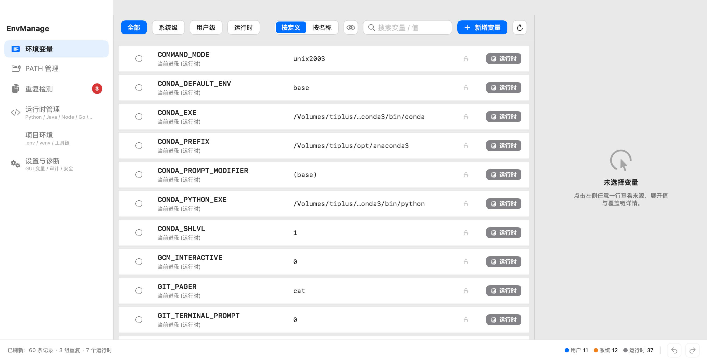
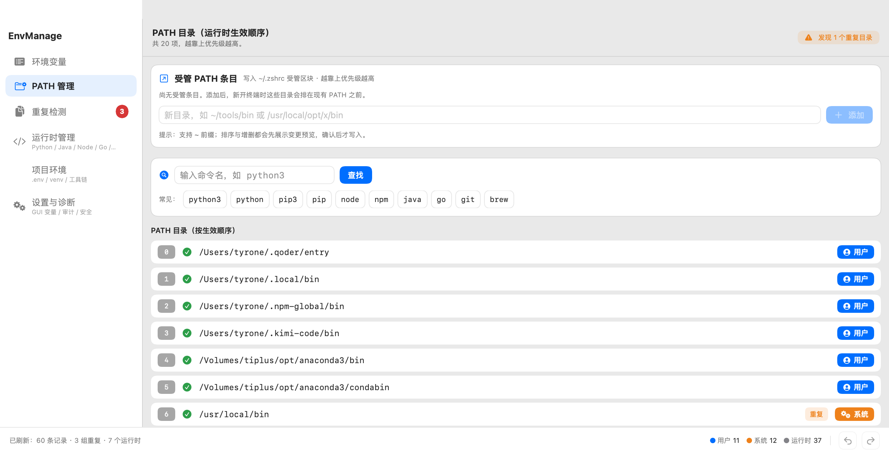
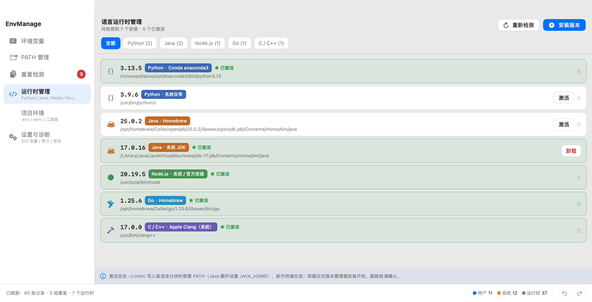
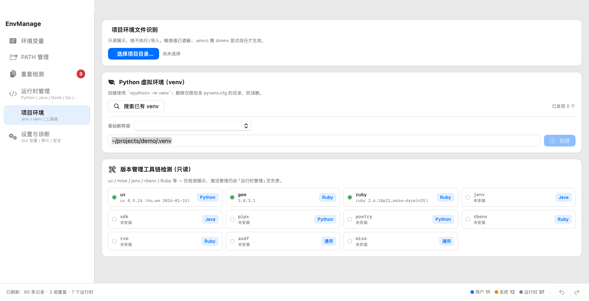
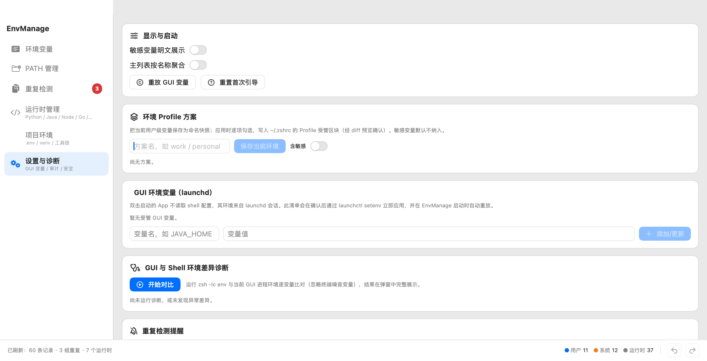

# EnvManage — macOS 原生环境变量管理工具

EnvManage 是一款**纯原生 macOS 应用**（SwiftUI 实现），用于可视化查看与修改系统/用户环境变量。
它不依赖任何第三方库、不启动任何 Web 服务、不会在打开软件后弹出网页——所有界面均为原生 SwiftUI 渲染，整体采用浅色主题。

## 界面截图

**环境变量主页**——系统/用户/运行时三色区分，右侧详情面板：



**PATH 管理页**——受管 PATH 区块增删排序 + 命令查找器：



**运行时管理页**——Python / Java / Node / Go / C++ 多版本激活与安装：



**项目环境页**——.env / .python-version / .envrc 只读识别、venv 创建与工具链检测：



**设置与诊断页**——Profile 方案 / GUI 变量 / 差异诊断 / 审计日志：



> 截图由内置的隐藏调试模式自动生成：`EnvManage --screenshot <路径> --page <env|path|dup|runtime|project|settings>`（进程内抓窗，不需屏幕录制权限）。

## 功能一览

| 模块 | 能力 |
|------|------|
| 环境变量 | 自动扫描并明显区分 **系统级（橙）/ 用户级（蓝）/ 运行时（灰）** 三个来源；支持搜索、按作用域筛选、新增、编辑值、删除、**开关控制单个变量是否生效**；**右侧详情面板**展示来源/权限/原始值/**展开值**/运行时生效值/**同名覆盖链**/生效确认；**按定义 / 按名称聚合** 双视图；**敏感值默认遮蔽**；**Fish 配置（set -x）只读识别** |
| PATH 管理 | 按生效顺序展示运行时 PATH 的每个目录，校验存在性并标注重复/缺失；**受管 PATH 条目**：在 `~/.zshrc` 受管区块内增删/上下排序用户级目录；**命令查找器**：列出全部命中、第一命中、符号链接解析链与**被遮蔽项** |
| 重复检测 | 自动发现重复定义与 PATH 重复/失效目录，按 **D01 同文件 / D02 跨文件同值 / D03 跨文件异值 / D04 PATH 重复 / D06 失效目录** 分类给建议；支持一键禁用/删除多余项、**忽略此类提醒**（可恢复） |
| 运行时管理 | 统一管理 **Python / Java / Node.js / Go / C++** 多版本：激活/卸载/安装指定版本（实时日志）；展示虚拟环境；**工具链只读检测**（uv / mise / jenv / rbenv / Ruby 等） |
| 项目环境 | 选择项目目录后识别 `.env`（键名遮蔽展示）/ `.python-version` / `.tool-versions` / `mise.toml` / `.envrc`（信任模型：仅展示不执行）；**venv 创建/删除**（浅层扫描发现已有环境） |
| 设置与诊断 | **GUI（launchd）环境变量受管**（launchctl setenv + 启动重放）；**GUI vs Shell 环境差异诊断**（结果弹窗完整展示/可搜索/逐项复制）；**Profile 方案**（保存/逐项开关应用/两方案对比）；写操作**审计日志**；首次启动引导 |
| 安全机制 | 所有写操作先出**文件级 diff 变更预览**，确认后才落盘；写入前**基线哈希校验**（拒绝覆盖外部修改）+ **zsh -n 语法预检** + 自动备份；系统文件仅**白名单**内可提权写（/etc/paths* 一律只读）；全量**撤销/重做**（⌘Z / ⇧⌘Z） |
| 菜单栏 | 常驻 **MenuBarExtra** 快捷入口：刷新 / 显示主窗口 / 跳转设置诊断 / 最近操作审计 |

界面为**左侧纵向导航 + 右侧内容页 + 底部状态栏**布局，整体浅色主题。

## 快速开始

### 直接运行发行包

```bash
# 方式一：挂载 DMG，把 EnvManage.app 拖入 Applications
open dist/EnvManage.dmg

# 方式二：直接打开已构建好的 App
open dist/EnvManage.app
```

### 从源码构建

只需要 macOS 自带工具链（swiftc / iconutil / codesign / hdiutil），无需 Xcode 工程：

```bash
bash build.sh
# 产物: dist/EnvManage.app  dist/EnvManage.dmg
```

### 无界面自检（验证核心逻辑）

```bash
./dist/EnvManage.app/Contents/MacOS/EnvManage --selftest
```

## 项目结构

```
envmanage/
├── build.sh                      # 一键编译打包脚本（.app + .dmg）
├── Sources/
│   ├── App/                      # 入口 / 菜单命令 / 帮助窗口 / 自检
│   │   ├── EnvManageApp.swift
│   │   ├── HelpWindow.swift
│   │   ├── ScreenshotMode.swift          # 隐藏截图模式（README 配图自动生成）
│   │   └── SelfTest.swift
│   ├── Models/                   # 纯数据模型
│   │   ├── EnvironmentVariable.swift
│   │   ├── PathEntry.swift
│   │   ├── RuntimeLanguage.swift         # Python/Java/Node/Go/C++ 大类
│   │   ├── RuntimeInstall.swift          # 统一运行时安装模型
│   │   ├── RuntimeEnvironment.swift      # 虚拟环境（venv/conda env）
│   │   └── DuplicateGroup.swift
│   ├── Services/                 # 业务逻辑（解析/编辑/备份/去重/运行时/撤销）
│   │   ├── ShellConfigService.swift      # 扫描解析 shell/fish 配置文件
│   │   ├── FileStore.swift               # 统一写入层（哈希基线+语法预检+备份+撤销+提权白名单）
│   │   ├── FileSnapshotUndoManager.swift # 文件快照式撤销/重做
│   │   ├── BackupService.swift           # 自动备份
│   │   ├── DiffService.swift             # 行级 diff（变更预览）
│   │   ├── WriteAudit.swift              # 审计日志 + 系统写白名单
│   │   ├── EditService.swift             # 变更计划 plan* / 应用 apply / 安全护栏
│   │   ├── PathService.swift             # PATH 拆分与校验
│   │   ├── ManagedPathService.swift      # 受管 PATH 区块（增删/排序）
│   │   ├── DuplicateService.swift        # 重复检测与 D01-D06 分类
│   │   ├── ShellTool.swift               # which/glob/流式执行共享工具
│   │   ├── ValueExpander.swift           # 值展开预览（~ / $VAR / ${VAR}）
│   │   ├── CommandResolver.swift         # 命令查找器：PATH 命中/遮蔽/软链解析
│   │   ├── DiagnosticsService.swift      # GUI vs Shell 环境差异诊断
│   │   ├── GuiEnvService.swift           # launchd GUI 变量受管（launchctl）
│   │   ├── ProfileService.swift          # 环境 Profile 方案（保存/对比/应用）
│   │   ├── ProjectEnvScanner.swift       # 项目环境文件识别（.env/.envrc 等）
│   │   ├── VenvService.swift             # venv 发现/创建/删除
│   │   ├── ToolboxService.swift          # uv/mise/jenv/Ruby 等工具链只读检测
│   │   ├── LanguageRuntimeProvider.swift # 各语言 Provider 统一协议
│   │   ├── PythonRuntimeProvider.swift   # Python 检测 + venv/conda env 挂载
│   │   ├── JavaRuntimeProvider.swift     # JDK/SDKMAN/brew 检测 + JAVA_HOME
│   │   ├── NodeRuntimeProvider.swift     # nvm/fnm/volta/brew 检测
│   │   ├── GoRuntimeProvider.swift       # 官方pkg/gimme/brew 检测
│   │   ├── CppRuntimeProvider.swift      # Apple Clang/brew GCC/LLVM 检测
│   │   ├── RuntimeService.swift          # 激活/卸载统一编排
│   │   ├── RuntimeInstallService.swift   # 通过版本管理器安装指定版本
│   │   └── AppPaths.swift                # 路径常量与标记约定
│   ├── ViewModels/
│   │   └── EnvManagerViewModel.swift     # 状态管理与编排
│   └── Views/                    # SwiftUI 视图（浅色主题）
│       ├── Theme.swift                   # 配色 / 语言图标映射
│       ├── ContentView.swift             # 根视图（左侧纵向导航 + 状态栏）
│       ├── Components.swift              # 徽标 / 空态等复用组件
│       ├── EnvironmentVariablesView.swift
│       ├── VariableRowView.swift
│       ├── VariableDetailPanel.swift     # 右侧详情面板（展开值/覆盖链/定位）
│       ├── VariableSheets.swift          # 新增/编辑弹窗
│       ├── PathEntriesView.swift
│       ├── CommandFinderView.swift       # 命令查找器 UI
│       ├── DuplicatesView.swift
│       ├── RuntimeManagerView.swift      # 运行时管理（激活/卸载/虚拟环境）
│       ├── ProjectEnvView.swift          # 项目环境 / venv / 工具链检测
│       ├── EnvDiffSheet.swift            # 环境差异诊断结果弹窗
│       ├── SettingsView.swift            # 设置与诊断（Profile/GUI变量/审计/引导）
│       ├── ChangePreviewSheet.swift      # 写操作 diff 预览确认
│       └── InstallRuntimeSheet.swift     # 安装版本弹窗（实时日志）
├── Scripts/
│   └── make_icon.swift           # 程序化绘制应用图标（AppKit）
├── Resources/                    # 图标中间产物 (.iconset / .icns)
└── docs/
    ├── 使用文档.md                # 面向使用者的功能说明
    └── 设计与架构.md              # 架构设计决策文档
```

## 工作原理简述

- **变量来源**：解析 `/etc/paths`、`/etc/paths.d/*`、`/etc/zshenv|zprofile|zshrc|profile` 等系统文件（系统级），`~/.zshenv|~/.zprofile|~/.zshrc|~/.bash_profile|~/.bashrc`（用户级），以及 `ProcessInfo` 进程环境（运行时）。
- **安全写入流水线**：所有写操作经 `EditService.planXxx` 先在内存中演算出 `FilePlan`（原内容→新内容），弹出 **diff 变更预览**确认后，由 `FileStore.write` 执行：基线哈希校验（拒绝覆盖外部修改）→ `zsh -n` 语法预检 → 备份 → 撤销快照 → 落盘 → 审计日志（jsonl）。提权写仅限白名单 `/etc/zshenv|zprofile|zshrc|profile`；`/etc/paths*` 一律只读。
- **受管区块**：运行时激活按语言维护 `~/.zshrc` 中的标记块；PATH 受管条目、Profile 方案应用同样使用独立标记块（`# >>> EnvManage PATH/Profile >>>`），互不干扰。
- **GUI 环境变量**：`launchctl setenv/unsetenv` 作用于当前 GUI 会话，清单持久化在 Application Support，EnvManage 启动时自动重放。
- **开关实现**：禁用变量时在 export 行前插入可还原标记 `#ENVManage-disabled#` 并注释该行，恢复时原样还原，不破坏文件语义。
- **运行时激活**：在 `~/.zshrc` 中按语言维护带标记的受管块（如 `# >>> EnvManage Runtime:python >>>`），Java 额外写入 `JAVA_HOME`；切换即替换对应块，互不干扰。
- **卸载**：仅对版本管理器目录（pyenv/nvm/sdkman 等）开放，直接删除版本目录；系统目录需管理员授权；brew 维护的安装提示用 `brew uninstall`。
- **安装**：调用本机已有版本管理器（pyenv install / nvm install / sdk install / brew install 等），输出实时流式回传界面。
- **安全**：见上「安全写入流水线」；非简单赋值语句（含 `&&`/管道/命令替换等）拒绝原位改删；失败时写入回滚并提示刷新。

## 环境要求

- macOS 13.0+（构建机器实测 macOS 26.x + Swift 6.1.2）
- 仅需系统自带 Swift 工具链，无第三方依赖